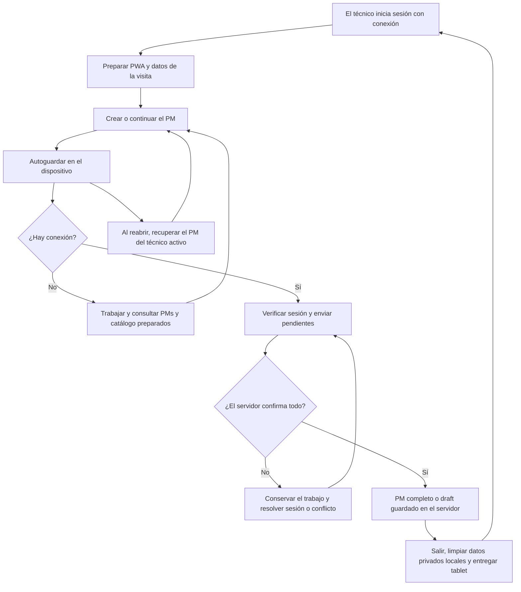
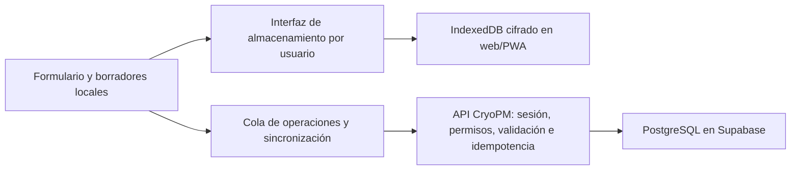

# CryoPM: persistencia y trabajo sin conexión en PWA

Fecha: 5 de noviembre de 2026. Revisión 3. Estado: **requisitos de PWA, consulta offline y concurrencia confirmados; implementación no iniciada**.

Rama: `codex/offline-persistence`, creada desde `main` (`3a1c5cd`). Este cambio documenta el trabajo; no modifica ni despliega la aplicación.

## 1. Objetivo y contexto confirmado

Un técnico debe poder conservar y continuar su PM ante una recarga, cierre de Safari o pérdida de señal; preparar el trabajo antes de bajar a un sótano; y sincronizarlo al recuperar conexión, sin duplicados ni pérdida silenciosa de cambios.

**Decisiones confirmadas por el usuario:**

- Se implementará una **PWA**. Capacitor y distribución en tiendas quedan fuera del alcance actual.
- La tablet se comparte **por turnos de visita**, con un solo técnico activo; no se requiere alternar varios técnicos trabajando offline en la misma tablet.
- Antes de que otro técnico use la tablet, el trabajo del anterior debe quedar confirmado en el servidor, como PM completo o como borrador.
- No se generará un PDF nuevo sin conexión. Sí debe funcionar una **vista previa local** para revisar el contenido del PM; el PDF oficial se obtiene del servidor después de sincronizar.
- Esto no elimina las funciones actuales de guardar borradores o iniciar otro PM para el mismo titular. La condición de entrega de la tablet comprende todos sus cambios pendientes.
- **Sin PIN adicional ni selector de técnicos offline.** La PWA recupera la visita del técnico activo; el relevo ocurre después de sincronizar y cerrar su sesión.
- La desconexión prevista dura la revisión y el PM, normalmente no más de una jornada. No introducir un corte que haga perder o interrumpa la captura del PM en curso.
- La PWA debe poder abrir su navegación y consultar los datos importantes preparados del usuario: PMs, detalle/vista previa, catálogo e imágenes de los modelos. La disponibilidad debe prepararse antes de perder señal, no depender de haber visitado cada pantalla.
- La administración de usuarios y las demás operaciones administrativas requieren conexión; no se encolan para ejecutarlas después.
- Varios técnicos pueden trabajar simultáneamente en otras tablets y ubicaciones. La sincronización se limita a cada PM y no debe sobrescribir ni bloquear el trabajo de los demás.

Situación comprobada en el código:

- `usePmWorkspace` mantiene campos, paso y trazos de firma en estado React. No existe persistencia local ni cola de sincronización.
- Save draft, Save & exit y Save and continue requieren la API. La navegación entre etapas espera el guardado remoto.
- `app/page.tsx` exige una sesión comprobada por el servidor. El catálogo también depende de una petición con `no-store`.
- La sesión del servidor dura actualmente 12 horas. Recargar sin conexión no puede reconstruir por sí solo la sesión ni la aplicación.
- El PDF se genera en el servidor. Las firmas pendientes no forman parte del borrador remoto.
- Hay controles de revisión y permisos que deben mantenerse, incluidos la identidad fija del equipo, las correcciones sin nuevas firmas y la consulta del creador tras una reasignación.

## 2. Flujo del técnico

El flujo completo requiere F1–F4: F3 incorpora apertura y consulta offline; F4 añade la vista previa y los cierres con firmas pendientes. F1 recupera borradores al recargar con acceso a la app, pero todavía no permite abrirla desde cero sin señal. La indicación «Guardado en este dispositivo» aparece únicamente después de confirmar la escritura local.

## 3. Tablet compartida por turnos: acceso y entrega

1. El técnico inicia su sesión habitual con internet antes de la visita y prepara los datos necesarios. Un usuario nuevo no puede autenticarse por primera vez sin conexión.
2. Durante la visita, la PWA conserva una sola identidad activa, asociada al ID estable del usuario. Los borradores, documentos y operaciones pendientes no se identifican por correo o nombre visible ni se reasignan a quien inicie sesión después.
3. **Decisión confirmada: sin PIN adicional.** Recuperar el trabajo con la identidad de la visita activa y el bloqueo físico de la tablet; no implementar varios perfiles offline. Esta modalidad no verifica por separado quién sostiene una tablet ya desbloqueada, por lo que la entrega exige sincronización y cierre de sesión del titular anterior.
4. Diseñar en F0 la protección del almacenamiento local y de sus claves para esta modalidad. Separar el alcance del cifrado en reposo de la comprobación de identidad; una clave guardada para desbloqueo automático no equivale a una contraseña personal. No copiar contraseñas de cuenta, cookies HttpOnly ni secretos del servidor a los registros locales.
5. **Entrega de tablet:** esperar la confirmación remota de todos los cambios y cierres pendientes, comprobar la última secuencia local y, después, cerrar la sesión, retirar claves/datos privados de memoria y limpiar las copias locales privadas ya sincronizadas. El borrador remoto permanece disponible para su titular según los permisos actuales.
6. No habilitar el cambio normal a otro técnico mientras quede trabajo sin confirmar en el servidor. Mostrar qué falta por sincronizar y permitir reintento o reautenticación del mismo titular. No bloquear la opción de proteger/bloquear la pantalla ni borrar datos para permitir el cambio de cuenta.
7. Si se cierra la app o se interrumpe la sesión con pendientes, conservarlos como recuperación del titular original. Otra sesión no debe verlos, enviarlos ni apropiárselos. Diseñar recuperación de una salida inesperada; no suponer que todos los cierres siguen el flujo normal.
8. **Uso offline previsto: una visita, normalmente dentro de una jornada.** Conservar y permitir continuar el PM preparado, sin bloquear su captura a mitad de la revisión por un vencimiento remoto. La sesión del servidor sigue durando 12 horas: al reconectar se pide el login del mismo técnico si venció antes de sincronizar. Esto no autoriza nuevos usuarios offline ni operaciones administrativas; no se define una eliminación automática al terminar la jornada.
9. La revocación remota no puede conocerse instantáneamente sin señal. Al reconectar se revalidan cuenta, rol y acceso al PM. Una cuenta desactivada o un PM reasignado suspende el envío y conserva la copia para resolverlo, sin transferirla ni publicarla automáticamente.
10. No borrar pendientes en un cierre de sesión, actualización o mantenimiento de papelera. Una eliminación voluntaria de un borrador local debe ser explícita y distinguible de eliminar un PM remoto.

La persistencia del navegador no equivale a respaldo: el usuario puede borrar datos del sitio y el sistema puede imponer límites de almacenamiento. Solicitar persistencia donde esté disponible y gestionar fallos de escritura; no prometer recuperación después de desinstalar o borrar los datos del sitio.

## 4. Estados que verá el usuario

| Estado | Significado y acción |
| --- | --- |
| Guardando en el dispositivo | La escritura local todavía no está confirmada. |
| Guardado en este dispositivo | La copia local se confirmó; no implica envío al servidor. |
| Pendiente de sincronizar | Hay cambios locales pendientes; se puede continuar la visita del técnico activo y consultar sus datos preparados. |
| Sincronizando | Se intenta enviar una operación ya conservada localmente. |
| Sincronizado | El servidor confirmó la operación y su revisión. Mostrar última hora de sincronización. |
| Requiere iniciar sesión | Hace falta volver a autenticar al mismo titular para sincronizar; el trabajo se conserva. |
| Requiere revisión | Conflicto, cambio de permisos o plantilla no compatible. Conservar contenido y explicar el motivo. |
| No se pudo guardar en el dispositivo | No mostrar éxito. Mantener el formulario abierto, avisar y ofrecer reintento o recuperación protegida. |

«Sin conexión» es un indicador independiente del estado del guardado. No confiar solamente en `navigator.onLine`: una red puede estar conectada y no llegar a la API.

La consulta offline muestra «Datos actualizados hasta…». No presentar como información en vivo los cambios que otros técnicos hayan realizado mientras la tablet estaba sin señal. Al reconectar, actualizar las copias de consulta sin reemplazar silenciosamente un formulario abierto con cambios locales.

## 5. Arquitectura propuesta

- Conservar Hostinger y Supabase como servidor y base central. Ninguna credencial de PostgreSQL ni clave privilegiada de Supabase se incluye en el navegador o en la app.
- Separar la lógica de guardado/recuperación/sincronización de React y del motor de almacenamiento para facilitar pruebas y mantenimiento. El único cliente instalable previsto en este alcance es la PWA.
- Encapsular la infraestructura en módulos propuestos `features/offline/` y `lib/pm/sync/`. Mantener validaciones PM compartidas entre interfaz y servidor. Los nombres concretos se pueden ajustar al implementar.
- Añadir el ID estable del usuario al contexto cliente mínimo; actualmente `PmWorkspace` recibe solo nombre visible y rol. Esto no sustituye la autorización del servidor.
- Mantener el guardado local independiente de las validaciones necesarias para crear o cerrar un PM remoto: un formulario incompleto o una medición parcialmente escrita también deben poder recuperarse.

### Registro local y cola

Guardar de forma versionada: ID local UUID, titular, ID remoto si existe, revisión remota de partida, secuencia local, marca/modelo y referencia de catálogo/plantilla, valores originales de los campos, respuestas, notas, mediciones, unidades, paso de edición, marcas de tiempo y estado de sincronización. Las firmas y declaraciones se incorporan en F4 bajo la protección definida en F0.

La escritura del último contenido y de su operación pendiente debe ser atómica. Las escrituras asíncronas antiguas no pueden sobrescribir estados más recientes. Guardar durante la edición, con una latencia objetivo de hasta un segundo en condiciones normales y confirmación al salir; no depender solo de `beforeunload`, que no cubre todos los cierres de iOS. Lo que aún no se confirmó como escrito puede perderse en un cierre abrupto.

Conservar las funciones actuales de Save & exit y New PM para el técnico activo. Save & exit guarda localmente y permite recuperar el PM; no equivale a entregar la tablet a otro técnico. Identificar claramente los pendientes del titular en Reports. Todos deben sincronizarse antes de cambiar de usuario. No asignar un número PM oficial antes de que el servidor lo confirme; usar «Borrador local» y una referencia provisional.

El autoguardado de una captura no equivale a crear formalmente el PM: no bloquear marca/modelo al primer carácter. Mantener el bloqueo de identidad después del primer guardado formal o avance aceptado, incluido el equivalente offline. Crear una corrección requiere partir de la última versión conocida y validar de nuevo en el servidor; no sobrescribir el informe firmado.

### Protocolo de sincronización

1. Cada creación, actualización y cierre tiene un identificador de operación estable, vinculado al titular, al dispositivo y al contenido. Los reintentos reutilizan ese identificador.
2. El servidor registra la operación de forma transaccional junto al cambio. Repetir una petición ya aceptada devuelve su resultado; no crea otro PM, otra revisión ni otra firma. Un mismo identificador con otro contenido se rechaza.
3. La creación devuelve el ID y número remoto. Los cambios posteriores del mismo PM se ordenan y se enlazan a ese resultado; un fallo de conexión después del commit no dispara una segunda creación.
4. Mantener `expectedRevision`. Un conflicto conserva las dos versiones y suspende el envío de ese PM. Para esta primera entrega se propone resolución explícita; no mezclar automáticamente campos, lecturas ni firmas.
5. Si el usuario edita durante un envío, confirmar únicamente la secuencia enviada. Los cambios más nuevos permanecen pendientes y se envían después con la revisión confirmada.
6. Asegurar un solo emisor por cuenta/PM entre pestañas o instancias; la idempotencia del servidor sigue siendo obligatoria. Diseñar exclusión y recuperación de bloqueos abandonados.
7. Reintentar con espera progresiva. Ofrecer «Sincronizar ahora» y reintentar al recuperar conectividad o volver a primer plano. No prometer sincronización con la app cerrada.
8. Diferenciar desconexión/timeout, 401, 403, 404/PM eliminado, 409 y validación. No convertir un rechazo de permisos en un PM nuevo ni eliminar el pendiente para ocultar el error.
9. Conservar siempre la última copia recuperable hasta confirmar el resultado. La política de 25 días de Trash no se aplica a trabajo local todavía no sincronizado.

### Varios técnicos en ubicaciones distintas: no interferencia

- **La unidad de sincronización es el PM**, no una copia completa de la base, del listado ni del catálogo. Enviar únicamente operaciones sobre registros identificados; no subir tablas completas, truncar datos ni borrar registros porque no aparezcan en una copia local.
- Cada petición comprueba su titular, permisos actuales, revisión base y campos admitidos. La cola de PMs no incluye usuarios, roles, asignaciones, catálogo, Trash ni configuraciones administrativas.
- Si A sincroniza PM-A y B trabaja en PM-B, ambos deben poder guardar. Emplear transacciones breves y acotadas al PM/operación, sin un bloqueo global de sincronización. Los contadores de numeración se asignan de forma segura en el servidor y no se reconstruyen desde la tablet.
- Si dos dispositivos cambian el **mismo PM**, comprobar `expectedRevision` de manera atómica con la escritura. Una copia antigua no puede reemplazar una versión nueva, un cierre firmado o una corrección posterior. Conservar el conflicto y avisar; no usar «gana la última petición».
- Un conflicto suspende solo las operaciones dependientes de ese PM. Los demás PMs y las colas de otros usuarios siguen funcionando. No duplicar automáticamente un PM para evadir el conflicto.
- Enviar lotes pequeños y limitar las peticiones simultáneas por dispositivo, con reintento gradual y variación de espera para evitar que varias tablets reconecten y saturen la API a la vez. Fijar los límites según las mediciones del piloto, no como un número arbitrario de carga máxima.
- Actualizar catálogos, consultas y estadísticas por separado de los envíos. La llegada de datos nuevos no recarga toda la PWA, cambia la etapa ni descarta lo que otro técnico tenga abierto en su dispositivo.
- La respuesta de una operación identifica el PM, la revisión y la secuencia aceptada. Nunca aplicar una confirmación tardía de PM-A sobre PM-B porque el usuario cambió de pantalla.
- No afirmar ausencia absoluta de demora de red o base de datos: el criterio comprobable es que la sincronización no pierda, sobrescriba ni bloquee funcionalmente trabajo ajeno, y mantenga una latencia aceptable bajo la carga acordada del piloto.

### Toda la navegación disponible sin red, con datos preparados

Una PWA necesita guardar una versión coherente de la interfaz, no solo los datos del formulario. Diseñar un arranque local sin información privada y recuperar los datos preparados del técnico activo con la política confirmada de la sección 3. La primera sesión y preparación se hacen con internet.

| Apartado | Disponible offline | Requiere conexión |
| --- | --- | --- |
| Overview | Estadísticas e información calculadas con la copia local autorizada, indicando su fecha de actualización | Consultar cambios recientes de otros dispositivos y obtener datos actuales del servidor |
| PM workspace | Crear/continuar PMs del titular, completar etapas, guardar, firmar y previsualizar; cierre marcado como pendiente | Confirmación remota definitiva y validación actual de permisos |
| Reports | Buscar, paginar y abrir los PMs autorizados descargados, su detalle y las versiones preparadas; distinguir cambios locales de la última copia remota | Descargar cambios nuevos, crear/confirmar correcciones contra la última versión, eliminar/restaurar y emitir PDF oficial |
| Equipment | Consultar marcas, modelos, información e imágenes descargadas; seleccionar un modelo preparado para el PM | Crear/editar/desactivar marcas o modelos, cambiar plantillas y subir archivos |
| Datasheets | Ver documentos descargados y verificados antes de perder conexión, si se incluyen en la preparación | Descargar un documento que aún no está en el dispositivo |
| Users y administración | Abrir la sección con un aviso claro de que requiere conexión, conservando los permisos de navegación por rol | Crear/editar/desactivar cuentas, contraseñas, invitaciones, roles, reasignaciones y cualquier otra mutación administrativa |

La consulta offline respeta el alcance actual: un técnico prepara los PMs que puede consultar, no todos los de la empresa. El administrador también debe ver disponibilidad y tamaño del conjunto preparado; no dar por descargado todo el historial remoto sin haberlo verificado.

**Preparación de datos importantes:**

- Preparar automáticamente el catálogo y las imágenes de los modelos registrados a los que el usuario tiene acceso, sin exigir abrir antes cada ficha. Usar las imágenes optimizadas del catálogo, no crear copias grandes innecesarias.
- La preparación de Reports recorre **todas las páginas** del conjunto autorizado: no confundir la página visible de 25 registros con una copia offline completa. Descargar metadatos, detalle y las versiones/referencias necesarias para lo que se declare disponible. Importar y paginar localmente por lotes para no cargar todo de golpe en memoria.
- Comprobar cuota y tamaño antes de preparar grandes historiales o documentos; mostrar progreso, cantidad preparada/total y fallos. Si no cabe todo, conservar los borradores pendientes y avisar explícitamente qué datos no estarán disponibles; no sustituirlos por una lista vacía ni declarar preparación completa.
- Asociar imágenes/documentos a ID de modelo y versión o huella del recurso. Confirmar la descarga completa y el contenido esperado: una respuesta de login, HTML o error no cuenta como imagen/documento disponible.
- Actualizar un recurso con conexión solo cuando la nueva descarga sea válida. Mantener la última imagen válida mientras se descarga o si hay una desconexión. Si nunca se descargó, mostrar un marcador de «No disponible sin conexión» sin romper la ficha.
- Distinguir recursos públicos de interfaz de datos/documentos privados. El service worker guarda recursos públicos versionados; los datos privados preparados usan almacenamiento protegido por titular. No cachear indiscriminadamente HTML autenticado, Users ni todas las respuestas API.
- Mantener las protecciones actuales de sesión, permisos, CSP y origen. Adaptar el arranque que hoy exige `requireUser` remoto sin abrir APIs privadas ni eliminar globalmente sus cabeceras de seguridad/caché.
- Mostrar «Listo para trabajar sin conexión» solo tras confirmar el arranque, el técnico activo y los PMs, catálogo e imágenes previstos. Informar por separado de los datasheets opcionales que falten.
- Desacoplar el avance del formulario del éxito de la API: validar la etapa, confirmar la escritura local y después encolar el envío.
- Versionar almacenamiento, plantillas y caché. Una actualización no debe recargar un PM abierto ni borrar pendientes. Probar migración y reversión, conservando los recursos del cliente anterior mientras tenga trabajo activo.
- Antes de entregar la tablet a otro técnico, sincronizar y limpiar los datos privados del anterior según la sección 3. No reutilizar su historial privado como caché de otro usuario.

### Firmas, cierre y PDF

- En F4, recuperar los trazos en el canvas además de su contenido almacenado; el componente actual solo emite una imagen y no restaura una firma al montar.
- Si se cierra como draft con trazos pendientes, F4 debe permitir conservarlos protegidos como datos provisionales también en el servidor, sin convertirlos en un cierre firmado. El guardado de draft actual no los incluye. No mostrar «todo sincronizado» ni limpiar esos trazos al entregar la tablet hasta confirmar su conservación remota o un descarte explícito del titular.
- Conservar trazo, nombre, declaraciones aceptadas, versión de plantilla y huella exacta del contenido firmado. Separar la hora declarada de captura offline de la recepción del servidor; no simular hora certificada o información de red que no existió.
- El cierre local congela su contenido y se muestra como **cierre pendiente de sincronizar**, no como PM aceptado por el servidor. Revalidar permisos, revisión y reglas completas antes de registrarlo remotamente.
- Tras recuperar conexión, un paquete válido se sincroniza sin pedir de nuevo las firmas solo por haber pasado tiempo. Un conflicto o alteración del contenido firmado detiene el proceso y exige resolución; no reutilizar las firmas sobre otro contenido.
- Las correcciones de PMs completados conservan las referencias a las firmas originales y no solicitan firmas nuevas, según la regla vigente.
- **Decisión confirmada:** el PDF oficial permanece en el servidor y está disponible tras sincronizar. No implementar generación de PDF offline en este alcance.
- Incorporar **vista previa offline del PM actual**, construida desde el contenido guardado localmente y las mismas reglas de presentación del documento. No depender de recuperar `ReportDetail` o imágenes de firmas desde la API para mostrarla. La previsualización existente usa datos del servidor: debe adaptarse, no darse por disponible offline automáticamente.
- Identificar el documento local como borrador o cierre pendiente, según corresponda, con fecha/hora de la copia y referencia local si todavía no existe número oficial. Revisar tablas, unidades, notas y trazos sin fabricar una confirmación del servidor. La vista previa no sustituye el PDF oficial ni implica aceptación remota.

## 6. Fases y condiciones de aceptación

| Fase | Entrega | Se considera terminada cuando… |
| --- | --- | --- |
| F0 — Diseño técnico y entrega por turnos | Acceso sin PIN extra, protección local, recuperación y entrega; contratos de datos, concurrencia y preparación | Se especifica el mecanismo con las decisiones ya confirmadas y se demuestra cómo impedir entrega con pendientes, exposición de datos anteriores y escrituras sobre PMs ajenos. |
| F1 — Recuperación local | Autoguardado del técnico activo, recuperación y estados visibles | Con conexión, una recarga o cierre/reapertura recupera identidad, valores incompletos, notas, unidades y etapa del mismo titular; B no accede al trabajo de A y la entrega exige sincronización. No se afirma todavía apertura offline completa. |
| F2 — Sincronización fiable y concurrente | Cola por PM, idempotencia, revisiones atómicas, reautenticación y conflictos aislados | Reintentar produce un solo PM; dos técnicos guardan PMs distintos sin sobrescribirse; un conflicto del mismo PM no bloquea los otros; las confirmaciones tardías no pierden cambios. |
| F3 — Consulta y trabajo completo sin red | Arranque PWA, PMs autorizados, Overview local, catálogo e imágenes preparados; administración bloqueada | En modo avión y tras reabrir se puede navegar, consultar Reports, abrir fichas con imágenes y continuar el PM. Los datos faltantes/antiguos se identifican; ninguna acción administrativa se ejecuta ni se encola. |
| F4 — Firmas, vista previa y cierre | Captura/restauración protegida, previsualización local y cierre pendiente; PDF remoto | Se recuperan trazos, la vista previa abre sin red y refleja el contenido local; sincronizar no duplica ni altera firmas; el PDF oficial posterior refleja lo aceptado. |
| F5 — Piloto Apple | QA en iPhone/iPad reales y matriz de fallos; procedimiento de recuperación | Pasan los escenarios de la sección 7 y se verifica un turno con tablets compartidas. Publicación gradual con reversión probada. |

F1–F4 incluyen sus propias pruebas; F5 no sustituye la verificación continua. El cierre de F5 entrega la PWA; no hay una fase Capacitor dentro del alcance acordado. F0 cierra el diseño técnico, no reabre la elección de PIN, duración esperada ni PDF ya aclaradas. No se fijan fechas ni costes de implementación hasta terminar ese diseño.

## 7. Matriz mínima de QA

| Escenario | Resultado esperado |
| --- | --- |
| Editar identificación incompleta y recargar | Recuperación fiel, sin exigir validación remota para guardar localmente. |
| Cerrar Safari desde el selector de apps tras confirmar guardado | Recuperación de la última escritura confirmada. |
| Perder internet durante edición y avanzar | Trabajo local y etapas conservados; aviso de pendientes. |
| Modo avión antes de abrir una tablet preparada | Arranque local y recuperación limitada al técnico activo según la política acordada. |
| Primera apertura sin preparación | Mensaje explícito de que hace falta conexión; sin falso estado de «listo». |
| Abrir Overview, Reports y Equipment en modo avión | Datos preparados consultables y fechados; navegación sin pantallas vacías por peticiones fallidas. |
| Consultar PMs de páginas que no estaban visibles antes de desconectarse | Acceso a todos los registros y detalles confirmados como preparados, no solo a los primeros 25. |
| Abrir fichas de modelos nunca visitadas individualmente | Imágenes preparadas disponibles, con tamaño y correspondencia correctos. |
| Imagen nueva interrumpida o sin espacio | Se conserva la última válida; las carencias se informan y no se evictan borradores pendientes. |
| Intentar administrar usuarios, reasignar o modificar catálogo sin señal | Acción bloqueada con explicación; no se crea una operación administrativa diferida. |
| Crear tres PMs offline con Save & exit | Tres borradores distintos, reanudables y sin identidades mezcladas. |
| Servidor acepta crear, pero se pierde la respuesta | Un solo PM tras reconectar y reintentar. |
| Editar mientras llega la confirmación de un envío anterior | Se confirma solo la versión enviada; la nueva edición sigue pendiente. |
| Dos pestañas / dos dispositivos modifican el mismo PM | Exclusión local cuando corresponda; comprobación atómica de revisión y conflicto conservado, sin sobrescritura. |
| A vuelve con pendientes de PM-A mientras B guarda PM-B desde otra tablet | Ambos trabajos se conservan en sus registros y revisiones; ninguno sobrescribe ni pausa funcionalmente al otro. |
| A tiene conflicto en PM-A y pendientes válidos en PM-C; B trabaja en PM-B | Solo se detiene la cadena de PM-A; PM-C y PM-B continúan sincronizando. |
| Varias tablets recuperan conexión simultáneamente | Lotes limitados y reintentos graduales; carga y latencia medidas sin pérdida de operaciones ni duplicados. |
| Llega una confirmación de PM-A cuando ya se está editando PM-B | Actualiza únicamente la operación/registro de PM-A y no cambia el formulario de PM-B. |
| Cambia o se elimina un registro en otro dispositivo mientras se estaba offline | No se restaura ni sobrescribe desde una lista antigua; el servidor valida el cambio o devuelve conflicto/permiso denegado. |
| A intenta entregar la tablet con pendientes | Se bloquea el cambio normal de técnico, se conserva el PM y se explica qué falta por enviar. |
| A sincroniza todo como completo o draft y entrega la tablet | El servidor conserva el trabajo, la sesión de A se cierra y B inicia su propia visita sin datos locales de A. |
| Se fuerza un cierre/salida con pendientes | Los datos no se borran ni se envían con otra identidad; se recuperan con el titular original. |
| Vence sesión, se desactiva la cuenta o se reasigna el PM | Reautenticación o revisión requerida; sin envío con identidad o permisos incorrectos. |
| Navegador sin espacio / IndexedDB falla | Aviso persistente, sin indicar guardado exitoso ni descartar contenido pendiente. |
| Actualizar la app con PM y cola activos | Sin pérdida de trabajo, mezcla de versiones ni activación inesperada. |
| Firmar, cerrar sin red y reabrir | Se recupera el contenido exacto y las marcas; cierre pendiente hasta confirmación remota. |
| Reintentar un cierre firmado | Un solo cierre remoto y una sola asociación de firmas. |
| Vista previa del PM actual en modo avión | Muestra mediciones, unidades, notas, estado y trazos locales sin consultar la API. |
| Solicitar un PDF nuevo sin conexión | Se informa que requiere sincronización; la vista previa local permanece accesible. |
| Rotar iPad, teclado flotante/físico, Pencil, VoiceOver | Campos, foco, respuestas, trazos y controles usables sin pérdida de datos. |
| Borrar deliberadamente datos del sitio/desinstalar | Comportamiento y límites de recuperación documentados; sin prometer recuperación de datos locales eliminados. |

Probar Safari y PWA instalada por separado, con suspensión/reanudación, señal intermitente y modo avión real. Verificar cambios de permisos y sesión con dos técnicos y un administrador de QA. Usar únicamente servicios, firmas y datos sintéticos.

## 8. Decisiones cerradas y trabajo técnico previo

**Confirmado por el usuario:** PWA; técnicos que comparten tablet por turnos; sin PIN adicional; offline durante la visita, normalmente dentro de una jornada; sincronización completa antes del relevo; navegación y consulta de datos importantes e imágenes preparados; administración solo online; vista previa offline y PDF oficial online; sincronización que respete el trabajo simultáneo de otros técnicos.

No queda pendiente volver a preguntar por un desbloqueo personal ni por la generación de PDF offline. Se mantiene la sesión remota de 12 horas y se reautentica al mismo titular al sincronizar si venció; el PM local no se borra ni se interrumpe por ese motivo.

F0 debe concretar la protección y recuperación de datos/claves en la modalidad sin PIN extra, el manifiesto de datos y recursos a preparar, control de cuota, las migraciones/API de idempotencia y revisión atómica, y los límites de carga para el piloto. Son decisiones de implementación dentro del alcance acordado. El dimensionado se ajustará al historial y a las tablets reales; las limitaciones detectadas se harán explícitas, sin prometer disponibilidad de datos que no se hayan descargado.

Mantener permisos actuales por rol, autoría y asignación. Un acceso local con la tablet ya desbloqueada no identifica por sí solo a una persona distinta; el proceso acordado se apoya en un único técnico activo y la entrega tras sincronización y cierre de sesión.

## 9. Instalación: PWA como alcance vigente

La entrega prevista es la PWA instalable desde Safari en la pantalla de inicio, con pruebas en iPhone/iPad reales. No se crean proyectos Capacitor ni se gestionan cuentas Developer, TestFlight o publicación en tiendas.

La comparación de distribución Apple investigada en la revisión anterior se conserva únicamente como antecedente en las referencias. Una app nativa futura sería una decisión nueva; no es requisito para ejecutar este plan.

## 10. Referencias verificadas el 5 de noviembre de 2026

- [WebKit: almacenamiento persistente, cuotas y posibles eliminaciones](https://webkit.org/blog/14403/updates-to-storage-policy/).
- [Capacitor para iOS](https://capacitorjs.com/docs/ios) y [configuración de recursos y server.url](https://capacitorjs.com/docs/config).
- [Apple: métodos de distribución pública, privada y no listada](https://developer.apple.com/help/app-store-connect/manage-your-apps-availability/set-distribution-methods).
- [Apple: Custom Apps para organizaciones](https://developer.apple.com/support/volume-purchase-and-custom-apps/).
- [Apple: TestFlight y vigencia de los builds](https://developer.apple.com/help/app-store-connect/test-a-beta-version/testflight-overview/).
- [Apple: membresía y precio del Developer Program](https://developer.apple.com/programs/whats-included/).

## 11. Entrega y control del alcance

Esta rama comienza con este plan. Cada fase se implementará con cambios revisables, pruebas adecuadas y evidencia de dispositivo real antes de considerarse lista para campo. Esta revisión actualiza exclusivamente el plan con los requisitos confirmados; no introduce todavía funcionalidad offline ni modifica el entorno publicado.

En esta entrega no se cambia código de la app, esquema de base de datos, credenciales, configuración de Hostinger/Supabase ni las dos webs del cliente. La integración en `main` y el despliegue de funcionalidad se realizarán después de implementar y verificar las fases acordadas.
