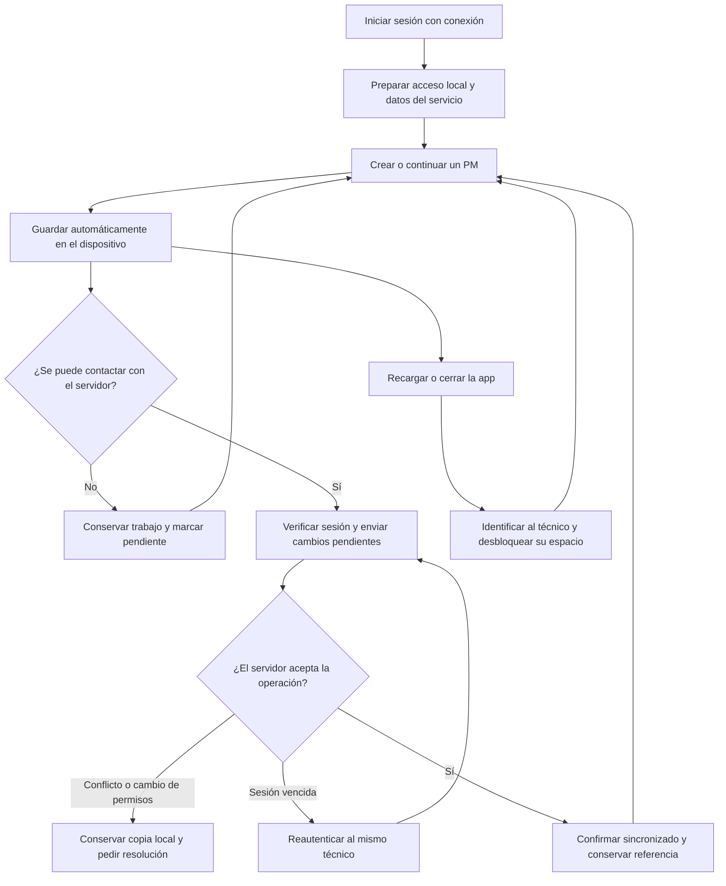
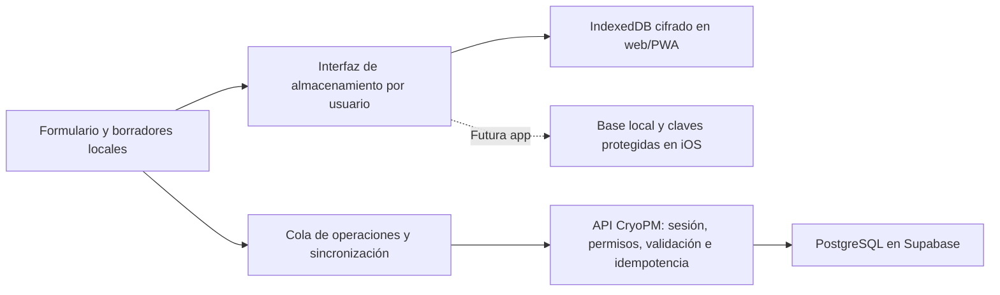

# CryoPM: persistencia, trabajo sin conexión y futura app Apple

Fecha: 5 de noviembre de 2026. Estado: **plan para revisión; implementación no iniciada**.

Rama: `codex/offline-persistence`, creada desde `main` (`3a1c5cd`). Este cambio documenta el trabajo; no modifica ni despliega la aplicación.

## 1. Objetivo y contexto confirmado

Un técnico debe poder conservar y continuar su PM ante una recarga, cierre de Safari o pérdida de señal; preparar el trabajo antes de bajar a un sótano; y sincronizarlo al recuperar conexión, sin duplicados ni pérdida silenciosa de cambios.

**El usuario confirmó que las tablets serán compartidas entre varios técnicos.** El acceso al dispositivo no equivale a acceso a todos los PMs: cada técnico debe identificarse y desbloquear exclusivamente sus datos locales.

Situación comprobada en el código:

- `usePmWorkspace` mantiene campos, paso y trazos de firma en estado React. No existe persistencia local ni cola de sincronización.
- Save draft, Save & exit y Save and continue requieren la API. La navegación entre etapas espera el guardado remoto.
- `app/page.tsx` exige una sesión comprobada por el servidor. El catálogo también depende de una petición con `no-store`.
- La sesión del servidor dura actualmente 12 horas. Recargar sin conexión no puede reconstruir por sí solo la sesión ni la aplicación.
- El PDF se genera en el servidor. Las firmas pendientes no forman parte del borrador remoto.
- Hay controles de revisión y permisos que deben mantenerse, incluidos la identidad fija del equipo, las correcciones sin nuevas firmas y la consulta del creador tras una reasignación.

## 2. Flujo del técnico

El diagrama describe el resultado completo, después de F3. F1 recupera borradores al recargar con acceso a la app, pero todavía no permite abrirla desde cero sin señal. La indicación «Guardado en este dispositivo» aparece únicamente después de confirmar la escritura local.

## 3. Tablets compartidas: reglas de identidad y acceso

1. El primer inicio de sesión y la preparación de cada técnico en cada tablet requieren conexión. Un usuario nuevo no puede darse de alta ni autenticarse por primera vez sin internet.
2. Identificar el espacio local por el ID estable del usuario, no por correo, nombre visible ni rol. Separar borradores, catálogo preparado, documentos y operaciones pendientes por cuenta.
3. Diseñar en F0 cifrado autenticado de los datos privados en reposo y un desbloqueo local personal. El filtro por `userId` por sí solo no es protección suficiente en una tablet compartida. No persistir contraseñas de la cuenta, cookies de sesión ni claves de descifrado junto al contenido cifrado.
4. El desbloqueo local no crea una sesión del servidor ni concede permisos nuevos. Las credenciales locales deben prepararse después de verificar online a su titular. Método, recuperación de clave y duración se cierran antes de programar F1.
5. Al cambiar de técnico, confirmar las escrituras locales, bloquear el espacio anterior y retirar de memoria sus datos y claves. Los pendientes de A permanecen protegidos: B no puede consultarlos, enviarlos con su sesión ni descartarlos.
6. Propuesta inicial: una habilitación offline de hasta 12 horas desde la última verificación online, alineada con la jornada y la sesión actual. Es una propuesta pendiente de revisión; no ampliar silenciosamente el acceso actual. Al vencer, bloquear lectura/edición hasta revalidar; conservar las copias cifradas y permitir su recuperación tras autenticación.
7. La revocación remota no puede conocerse instantáneamente sin señal. Al reconectar se revalidan usuario, rol y acceso al PM antes de cualquier operación. Una cuenta desactivada o un PM reasignado deja el envío bloqueado y el contenido preservado, sin transferirlo a otro usuario ni publicarlo automáticamente.
8. No usar una biometría compartida del dispositivo como única prueba de qué técnico está trabajando. Mantener autoría explícita y visible durante todo el flujo.
9. No borrar trabajo pendiente en un cierre de sesión, actualización, limpieza de caché o mantenimiento de papelera. La eliminación voluntaria de un borrador local debe ser explícita y distinguible de eliminar un PM remoto.

La persistencia del navegador no equivale a respaldo: el usuario puede borrar datos del sitio y el sistema puede imponer límites de almacenamiento. Solicitar almacenamiento persistente donde esté disponible, gestionar fallos de escritura y definir recuperación/exportación protegida; no prometer recuperación después de desinstalar o borrar los datos del sitio.

## 4. Estados que verá el usuario

| Estado | Significado y acción |
| --- | --- |
| Guardando en el dispositivo | La escritura local todavía no está confirmada. |
| Guardado en este dispositivo | La copia local se confirmó; no implica envío al servidor. |
| Pendiente de sincronizar | Hay cambios locales pendientes; se puede seguir trabajando si el acceso offline está habilitado. |
| Sincronizando | Se intenta enviar una operación ya conservada localmente. |
| Sincronizado | El servidor confirmó la operación y su revisión. Mostrar última hora de sincronización. |
| Requiere iniciar sesión | Hace falta volver a autenticar al mismo titular para sincronizar; el trabajo se conserva. |
| Requiere revisión | Conflicto, cambio de permisos o plantilla no compatible. Conservar contenido y explicar el motivo. |
| No se pudo guardar en el dispositivo | No mostrar éxito. Mantener el formulario abierto, avisar y ofrecer reintento o recuperación protegida. |

«Sin conexión» es un indicador independiente del estado del guardado. No confiar solamente en `navigator.onLine`: una red puede estar conectada y no llegar a la API.

## 5. Arquitectura propuesta

- Conservar Hostinger y Supabase como servidor y base central. Ninguna credencial de PostgreSQL ni clave privilegiada de Supabase se incluye en el navegador o en la app.
- Separar la lógica de guardado/recuperación/sincronización de React y del motor de almacenamiento. La futura app Capacitor reutilizará el contrato; su almacenamiento y autenticación se adaptarán a iOS.
- Encapsular la infraestructura en módulos propuestos `features/offline/` y `lib/pm/sync/`. Mantener validaciones PM compartidas entre interfaz y servidor. Los nombres concretos se pueden ajustar al implementar.
- Añadir el ID estable del usuario al contexto cliente mínimo; actualmente `PmWorkspace` recibe solo nombre visible y rol. Esto no sustituye la autorización del servidor.
- Mantener el guardado local independiente de las validaciones necesarias para crear o cerrar un PM remoto: un formulario incompleto o una medición parcialmente escrita también deben poder recuperarse.

### Registro local y cola

Guardar de forma versionada: ID local UUID, titular, ID remoto si existe, revisión remota de partida, secuencia local, marca/modelo y referencia de catálogo/plantilla, valores originales de los campos, respuestas, notas, mediciones, unidades, paso de edición, marcas de tiempo y estado de sincronización. Las firmas y declaraciones se incorporan en F4 bajo la protección definida en F0.

La escritura del último contenido y de su operación pendiente debe ser atómica. Las escrituras asíncronas antiguas no pueden sobrescribir estados más recientes. Guardar durante la edición, con una latencia objetivo de hasta un segundo en condiciones normales y confirmación al salir; no depender solo de `beforeunload`, que no cubre todos los cierres de iOS. Lo que aún no se confirmó como escrito puede perderse en un cierre abrupto.

Mantener varios borradores locales. Save & exit guarda localmente, cierra el PM y permite iniciar otro, aunque no haya señal. Mostrar pendientes del dispositivo por separado o claramente identificados dentro de Reports. No asignar un número PM oficial antes de que el servidor lo confirme; usar «Borrador local» y una referencia provisional.

El autoguardado de una captura no equivale a crear formalmente el PM: no bloquear marca/modelo al primer carácter. Mantener el bloqueo de identidad después del primer guardado formal o avance aceptado, incluido el equivalente offline. Crear una corrección requiere partir de la última versión conocida y validar de nuevo en el servidor; no sobrescribir el informe firmado.

### Protocolo de sincronización

1. Cada creación, actualización y cierre tiene un identificador de operación estable, vinculado al titular, al dispositivo y al contenido. Los reintentos reutilizan ese identificador.
2. El servidor registra la operación de forma transaccional junto al cambio. Repetir una petición ya aceptada devuelve su resultado; no crea otro PM, otra revisión ni otra firma. Un mismo identificador con otro contenido se rechaza.
3. La creación devuelve el ID y número remoto. Los cambios posteriores del mismo PM se ordenan y se enlazan a ese resultado; un fallo de conexión después del commit no dispara una segunda creación.
4. Mantener `expectedRevision`. Un conflicto conserva las dos versiones y suspende el envío de ese PM. Para esta primera entrega se propone resolución explícita; no mezclar automáticamente campos, lecturas ni firmas.
5. Si el usuario edita durante un envío, confirmar únicamente la secuencia enviada. Los cambios más nuevos permanecen pendientes y se envían después con la revisión confirmada.
6. Asegurar un solo emisor por cuenta/PM entre pestañas o instancias; la idempotencia del servidor sigue siendo obligatoria. Diseñar exclusión y recuperación de bloqueos abandonados.
7. Reintentar con espera progresiva. Ofrecer «Sincronizar ahora» y reintentar al recuperar conectividad o volver a primer plano. No prometer sincronización con la app cerrada.
8. Diferenciar desconexión/timeout, 401, 403, 404/PM eliminado, 409 y validación. No convertir un rechazo de permisos en un PM nuevo ni eliminar el pendiente para ocultar el error.
9. Conservar siempre la última copia recuperable hasta confirmar el resultado. La política de 25 días de Trash no se aplica a trabajo local todavía no sincronizado.

### Apertura completa sin red

Una PWA necesita guardar una versión coherente de la interfaz, no solo los datos del formulario. Diseñar un arranque local sin información privada y cargar el espacio de cada técnico únicamente después de su desbloqueo.

- Separar ese arranque de la página actual que exige `requireUser` en el servidor. No guardar indiscriminadamente HTML autenticado, respuestas de Users o todos los PMs en una caché común.
- El service worker almacena recursos públicos y versionados de la interfaz. Los datos privados preparados usan el almacenamiento protegido por usuario; los endpoints actuales no pierden sus controles ni su política de caché por un ajuste general.
- Preparar los PMs autorizados, catálogo y versiones de plantillas necesarios para la jornada. Datasheets e imágenes se descargan de forma explícita o controlada, indicando disponibilidad, tamaño y fallos.
- Mostrar «Listo para trabajar sin conexión» solo cuando estén completos el arranque, el acceso del técnico y los datos requeridos. Entrar por primera vez sin haber preparado la tablet no debe mostrar una promesa falsa de disponibilidad.
- Desacoplar el avance del formulario del éxito de una petición: validar la etapa y confirmar su escritura local, y después encolar el envío.
- Versionar almacenamiento, plantillas y caché. Una actualización pendiente no debe recargar un PM abierto ni borrar pendientes. Probar migración y reversión antes de activar la nueva versión; conservar recursos del cliente anterior mientras tenga trabajo activo.

### Firmas, cierre y PDF

- En F4, recuperar los trazos en el canvas además de su contenido almacenado; el componente actual solo emite una imagen y no restaura una firma al montar.
- Conservar trazo, nombre, declaraciones aceptadas, versión de plantilla y huella exacta del contenido firmado. Separar la hora declarada de captura offline de la recepción del servidor; no simular hora certificada o información de red que no existió.
- El cierre local congela su contenido y se muestra como **cierre pendiente de sincronizar**, no como PM aceptado por el servidor. Revalidar permisos, revisión y reglas completas antes de registrarlo remotamente.
- Tras recuperar conexión, un paquete válido se sincroniza sin pedir de nuevo las firmas solo por haber pasado tiempo. Un conflicto o alteración del contenido firmado detiene el proceso y exige resolución; no reutilizar las firmas sobre otro contenido.
- Las correcciones de PMs completados conservan las referencias a las firmas originales y no solicitan firmas nuevas, según la regla vigente.
- Base propuesta para el primer piloto offline: el PDF oficial permanece en el servidor y está disponible tras sincronizar. Descargar previamente un PDF existente es distinto de generar uno nuevo sin señal.
- **Decisión pendiente:** si el cliente necesita entregar un PDF nuevo dentro del sótano, añadir generación local y paridad con el PDF oficial como un entregable específico de F4. Cualquier documento previo a la aceptación remota debe identificar claramente su condición provisional; no simular un número oficial.

## 6. Fases y condiciones de aceptación

| Fase | Entrega | Se considera terminada cuando… |
| --- | --- | --- |
| F0 — Diseño de acceso compartido | Especificación de desbloqueo, claves, recuperación, vencimiento y cambio de cuenta; contrato de datos y cola | Están cerradas las decisiones de la sección 8 y probado el aislamiento previsto antes de guardar datos reales. |
| F1 — Recuperación local | Autoguardado por usuario, varios borradores, recuperación y estados visibles | Con conexión, una recarga o cierre/reapertura recupera identidad, valores incompletos, notas, unidades y etapa tras desbloquear al mismo técnico; B no accede al trabajo de A. No se afirma todavía apertura offline completa. |
| F2 — Sincronización fiable | Cola duradera, idempotencia, revisiones, reautenticación y resolución de conflictos | Cortar una respuesta después del commit y reintentar produce un solo PM; editar durante el envío no pierde cambios; los rechazos conservan el pendiente. |
| F3 — Trabajo completo sin red | Arranque PWA, preparación de jornada, catálogo y navegación local | Con la tablet preparada, modo avión + cierre total + reapertura permite continuar y crear varios PMs, avanzar etapas y usar Save & exit. Muestra claramente qué recursos no están descargados. |
| F4 — Firmas y cierre | Captura/restauración protegida, cierre offline pendiente y entrega del PDF acordada | Se recuperan trazos después de cerrar la app; sincronizar no duplica ni altera firmas; el documento aceptado corresponde al contenido capturado; las correcciones mantienen su regla vigente. |
| F5 — Piloto Apple | QA en iPhone/iPad reales y matriz de fallos; procedimiento de recuperación | Pasan los escenarios de la sección 7 y se verifica un turno con tablets compartidas. Publicación gradual con reversión probada. |
| F6 — Capacitor | Interfaz empaquetada localmente, adaptador de almacenamiento iOS, autenticación y distribución | Instalación/arranque en modo avión, cambio de técnico, sincronización y recuperación equivalentes en iPhone/iPad, con pruebas TestFlight y vía de distribución acordada. |

F1–F4 incluyen sus propias pruebas; F5 no sustituye la verificación continua. No iniciar F6 para ocultar carencias de persistencia de las fases anteriores. No se fijan fechas ni costes de implementación hasta cerrar F0 y el alcance del PDF.

## 7. Matriz mínima de QA

| Escenario | Resultado esperado |
| --- | --- |
| Editar identificación incompleta y recargar | Recuperación fiel, sin exigir validación remota para guardar localmente. |
| Cerrar Safari desde el selector de apps tras confirmar guardado | Recuperación de la última escritura confirmada. |
| Perder internet durante edición y avanzar | Trabajo local y etapas conservados; aviso de pendientes. |
| Modo avión antes de abrir una tablet preparada | Arranque local, identificación/desbloqueo del técnico y PMs preparados accesibles. |
| Primera apertura sin preparación | Mensaje explícito de que hace falta conexión; sin falso estado de «listo». |
| Crear tres PMs offline con Save & exit | Tres borradores distintos, reanudables y sin identidades mezcladas. |
| Servidor acepta crear, pero se pierde la respuesta | Un solo PM tras reconectar y reintentar. |
| Editar mientras llega la confirmación de un envío anterior | Se confirma solo la versión enviada; la nueva edición sigue pendiente. |
| Dos pestañas / dos dispositivos modifican el mismo PM | Exclusión local cuando corresponda; conflicto remoto conservado y visible. |
| A sale con pendientes y B entra en la misma tablet | B no ve ni sincroniza los datos de A; A puede recuperarlos al volver. |
| Vence sesión, se desactiva la cuenta o se reasigna el PM | Reautenticación o revisión requerida; sin envío con identidad o permisos incorrectos. |
| Navegador sin espacio / IndexedDB falla | Aviso persistente, sin indicar guardado exitoso ni descartar contenido pendiente. |
| Actualizar la app con PM y cola activos | Sin pérdida de trabajo, mezcla de versiones ni activación inesperada. |
| Firmar, cerrar sin red y reabrir | Se recupera el contenido exacto y las marcas; cierre pendiente hasta confirmación remota. |
| Reintentar un cierre firmado | Un solo cierre remoto y una sola asociación de firmas. |
| Rotar iPad, teclado flotante/físico, Pencil, VoiceOver | Campos, foco, respuestas, trazos y controles usables sin pérdida de datos. |
| Borrar deliberadamente datos del sitio/desinstalar | Comportamiento y límites de recuperación documentados; sin prometer recuperación de datos locales eliminados. |

Probar Safari y PWA instalada por separado, con suspensión/reanudación, señal intermitente y modo avión real. Verificar cambios de permisos y sesión con dos técnicos y un administrador de QA. Usar únicamente servicios, firmas y datos sintéticos.

## 8. Decisiones antes de ejecutar

Confirmado: tablets compartidas, dos roles actuales, conservación del creador tras reasignar, plantillas existentes por marca y correcciones sin nuevas firmas.

Pendiente de acordar en F0:

- Método de desbloqueo local de cada técnico, fortaleza de la credencial y recuperación de claves/datos pendientes si se olvida. No añadir un PIN corto sin evaluar el riesgo de intentos offline.
- Aprobar o ajustar la habilitación offline propuesta de 12 horas y el bloqueo por inactividad. Validar duración real de los turnos y procedimiento cuando una jornada se prolongue sin señal.
- Confirmar si el PDF nuevo debe poder entregarse sin red o si basta obtener el oficial después de sincronizar.
- Datos y documentos que deben prepararse por jornada y presupuesto de almacenamiento en las tablets que se compren.
- Custodia de la futura cuenta Apple Developer y alta del cliente en Apple Business para distribución privada. Preferencia propuesta: titularidad de la organización cliente.

El cifrado local y un desbloqueo adecuado protegen el dispositivo en reposo; no sustituyen seguridad contra scripts maliciosos mientras el espacio está abierto. Mantener CSP, validación, controles de origen, permisos y actualización de dependencias.

## 9. Distribución Apple: no exige una publicación pública

Capacitor empaqueta la interfaz en una app iOS gestionada con Xcode. Se instala código y recursos locales; el backend Next.js y PostgreSQL permanecen en el servidor. No configurar el producto como una simple ventana que carga la URL remota: ese esquema conserva la dependencia de red y `server.url` se documenta para desarrollo.

Antes de F6 hay que adaptar el inicio autenticado actual, el origen de las peticiones y la sesión a un cliente iOS instalado. Diseñar almacenamiento nativo y gestión de claves, además de un método de autenticación revocable y de alcance limitado; no abrir CORS a cualquier origen ni copiar secretos del servidor al binario. Mantener el motor de sincronización compartido.

| Vía | Uso previsto | Condiciones principales |
| --- | --- | --- |
| PWA desde Safari | Primera etapa web instalable en pantalla de inicio | No requiere publicación en App Store; no es el binario Capacitor. Mantener las limitaciones y pruebas de almacenamiento web. |
| TestFlight | Piloto de la app Capacitor con los técnicos | Se distribuye desde App Store Connect por invitación; no hay listado público. Cada build dura hasta 90 días y los testers externos pueden requerir revisión beta. No usarlo como distribución permanente sin mantenimiento. |
| Custom App privada | Opción propuesta para las tablets de la empresa | Disponible solo para las organizaciones indicadas en Apple Business (nombre actual de la plataforma empresarial). Se tramita en App Store Connect y requiere aprobación de Apple. La empresa puede distribuir mediante gestión de dispositivos o códigos de canje. |
| App no listada | Alternativa si la distribución corporativa no encaja | Se instala mediante enlace de App Store y no aparece en búsquedas. El enlace no es una barrera de acceso: cualquiera que lo obtenga puede descargarla; el login y los permisos siguen siendo necesarios. Requiere revisión y aprobación de la solicitud. |
| App Store pública | Si se amplía el producto a una audiencia general | Revisión y publicación pública; no es requisito para el caso actual. |

El Apple Developer Program cuesta actualmente **99 USD por año de membresía**, o precio local donde esté disponible. La firma, revisión y distribución siguen aplicándose aunque se use Capacitor. No se ha creado una cuenta, aceptado acuerdos ni realizado compras. MDM u otros servicios pueden tener costes separados según la solución elegida.

Recomendación para este cliente: PWA durante la primera etapa; TestFlight para probar el binario; Custom App privada para operación sostenida si la organización completa los requisitos. La decisión de distribución privada/pública debe tomarse antes de la aprobación: Apple exige un nuevo registro de app para cambiar entre ambas.

## 10. Referencias verificadas el 5 de noviembre de 2026

- [WebKit: almacenamiento persistente, cuotas y posibles eliminaciones](https://webkit.org/blog/14403/updates-to-storage-policy/).
- [Capacitor para iOS](https://capacitorjs.com/docs/ios) y [configuración de recursos y server.url](https://capacitorjs.com/docs/config).
- [Apple: métodos de distribución pública, privada y no listada](https://developer.apple.com/help/app-store-connect/manage-your-apps-availability/set-distribution-methods).
- [Apple: Custom Apps para organizaciones](https://developer.apple.com/support/volume-purchase-and-custom-apps/).
- [Apple: TestFlight y vigencia de los builds](https://developer.apple.com/help/app-store-connect/test-a-beta-version/testflight-overview/).
- [Apple: membresía y precio del Developer Program](https://developer.apple.com/programs/whats-included/).

## 11. Entrega y control del alcance

Esta rama comienza con este plan. Cada fase se implementará con cambios revisables, pruebas adecuadas y evidencia de dispositivo real antes de considerarse lista para campo. La aprobación del plan no concede por sí sola permisos para compras, cuentas Apple, cambios de credenciales ni publicación en tiendas.

En esta entrega no se cambia código de la app, esquema de base de datos, credenciales, configuración de Hostinger/Supabase ni las dos webs del cliente. La integración en `main` y el despliegue de funcionalidad se realizarán después de implementar y verificar las fases acordadas.
