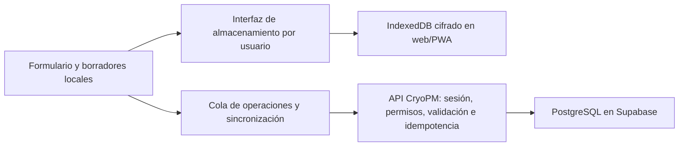

# CryoPM: persistencia y trabajo sin conexión en PWA

Fecha: 5 de noviembre de 2026. Revisión 2. Estado: **plan ajustado al flujo de visitas; implementación no iniciada**.

Rama: `codex/offline-persistence`, creada desde `main` (`3a1c5cd`). Este cambio documenta el trabajo; no modifica ni despliega la aplicación.

## 1. Objetivo y contexto confirmado

Un técnico debe poder conservar y continuar su PM ante una recarga, cierre de Safari o pérdida de señal; preparar el trabajo antes de bajar a un sótano; y sincronizarlo al recuperar conexión, sin duplicados ni pérdida silenciosa de cambios.

**Decisiones confirmadas por el usuario:**

- Se implementará una **PWA**. Capacitor y distribución en tiendas quedan fuera del alcance actual.
- La tablet se comparte **por turnos de visita**, con un solo técnico activo; no se requiere alternar varios técnicos trabajando offline en la misma tablet.
- Antes de que otro técnico use la tablet, el trabajo del anterior debe quedar confirmado en el servidor, como PM completo o como borrador.
- No se generará un PDF nuevo sin conexión. Sí debe funcionar una **vista previa local** para revisar el contenido del PM; el PDF oficial se obtiene del servidor después de sincronizar.
- Esto no elimina las funciones actuales de guardar borradores o iniciar otro PM para el mismo titular. La condición de entrega de la tablet comprende todos sus cambios pendientes.

Situación comprobada en el código:

- `usePmWorkspace` mantiene campos, paso y trazos de firma en estado React. No existe persistencia local ni cola de sincronización.
- Save draft, Save & exit y Save and continue requieren la API. La navegación entre etapas espera el guardado remoto.
- `app/page.tsx` exige una sesión comprobada por el servidor. El catálogo también depende de una petición con `no-store`.
- La sesión del servidor dura actualmente 12 horas. Recargar sin conexión no puede reconstruir por sí solo la sesión ni la aplicación.
- El PDF se genera en el servidor. Las firmas pendientes no forman parte del borrador remoto.
- Hay controles de revisión y permisos que deben mantenerse, incluidos la identidad fija del equipo, las correcciones sin nuevas firmas y la consulta del creador tras una reasignación.

## 2. Flujo del técnico

El diagrama describe el resultado completo, después de F3. F1 recupera borradores al recargar con acceso a la app, pero todavía no permite abrirla desde cero sin señal. La indicación «Guardado en este dispositivo» aparece únicamente después de confirmar la escritura local.

## 3. Tablet compartida por turnos: acceso y entrega

1. El técnico inicia su sesión habitual con internet antes de la visita y prepara los datos necesarios. Un usuario nuevo no puede autenticarse por primera vez sin conexión.
2. Durante la visita, la PWA conserva una sola identidad activa, asociada al ID estable del usuario. Los borradores, documentos y operaciones pendientes no se identifican por correo o nombre visible ni se reasignan a quien inicie sesión después.
3. **Recomendación para revisión, aún no decisión del usuario:** recuperar el trabajo usando la continuidad de ese técnico activo y el bloqueo físico de la tablet, sin añadir inicialmente otro PIN ni un selector de perfiles offline. Esto simplifica el flujo, pero no verifica por separado quién sostiene una tablet ya desbloqueada. Si se necesita esa verificación adicional, habrá que diseñar un desbloqueo personal y su recuperación antes de implementarlo.
4. Diseñar en F0 la protección del almacenamiento local y de sus claves para esta modalidad. Separar el alcance del cifrado en reposo de la comprobación de identidad; una clave guardada para desbloqueo automático no equivale a una contraseña personal. No copiar contraseñas de cuenta, cookies HttpOnly ni secretos del servidor a los registros locales.
5. **Entrega de tablet:** esperar la confirmación remota de todos los cambios y cierres pendientes, comprobar la última secuencia local y, después, cerrar la sesión, retirar claves/datos privados de memoria y limpiar las copias locales privadas ya sincronizadas. El borrador remoto permanece disponible para su titular según los permisos actuales.
6. No habilitar el cambio normal a otro técnico mientras quede trabajo sin confirmar en el servidor. Mostrar qué falta por sincronizar y permitir reintento o reautenticación del mismo titular. No bloquear la opción de proteger/bloquear la pantalla ni borrar datos para permitir el cambio de cuenta.
7. Si se cierra la app o se interrumpe la sesión con pendientes, conservarlos como recuperación del titular original. Otra sesión no debe verlos, enviarlos ni apropiárselos. Diseñar recuperación de una salida inesperada; no suponer que todos los cierres siguen el flujo normal.
8. La sesión remota actual de 12 horas no se amplía con este cambio. **Recomendación para revisión:** que el vencimiento no borre ni interrumpa la captura del PM ya preparado durante la visita; al reconectar, solicitar el login del mismo técnico si hace falta para sincronizar. El acceso local es limitado a ese trabajo preparado, no un nuevo login ni acceso a funciones administrativas. Acordar el plazo y el bloqueo local en F0; las 12 horas no son una política offline ya aprobada.
9. La revocación remota no puede conocerse instantáneamente sin señal. Al reconectar se revalidan cuenta, rol y acceso al PM. Una cuenta desactivada o un PM reasignado suspende el envío y conserva la copia para resolverlo, sin transferirla ni publicarla automáticamente.
10. No borrar pendientes en un cierre de sesión, actualización o mantenimiento de papelera. Una eliminación voluntaria de un borrador local debe ser explícita y distinguible de eliminar un PM remoto.

La persistencia del navegador no equivale a respaldo: el usuario puede borrar datos del sitio y el sistema puede imponer límites de almacenamiento. Solicitar persistencia donde esté disponible y gestionar fallos de escritura; no prometer recuperación después de desinstalar o borrar los datos del sitio.

## 4. Estados que verá el usuario

| Estado | Significado y acción |
| --- | --- |
| Guardando en el dispositivo | La escritura local todavía no está confirmada. |
| Guardado en este dispositivo | La copia local se confirmó; no implica envío al servidor. |
| Pendiente de sincronizar | Hay cambios locales pendientes; se puede continuar la visita del técnico activo con los datos preparados. |
| Sincronizando | Se intenta enviar una operación ya conservada localmente. |
| Sincronizado | El servidor confirmó la operación y su revisión. Mostrar última hora de sincronización. |
| Requiere iniciar sesión | Hace falta volver a autenticar al mismo titular para sincronizar; el trabajo se conserva. |
| Requiere revisión | Conflicto, cambio de permisos o plantilla no compatible. Conservar contenido y explicar el motivo. |
| No se pudo guardar en el dispositivo | No mostrar éxito. Mantener el formulario abierto, avisar y ofrecer reintento o recuperación protegida. |

«Sin conexión» es un indicador independiente del estado del guardado. No confiar solamente en `navigator.onLine`: una red puede estar conectada y no llegar a la API.

## 5. Arquitectura propuesta

- Conservar Hostinger y Supabase como servidor y base central. Ninguna credencial de PostgreSQL ni clave privilegiada de Supabase se incluye en el navegador o en la app.
- Separar la lógica de guardado/recuperación/sincronización de React y del motor de almacenamiento para facilitar pruebas y mantenimiento. El único cliente instalable previsto en este alcance es la PWA.
- Encapsular la infraestructura en módulos propuestos `features/offline/` y `lib/pm/sync/`. Mantener validaciones PM compartidas entre interfaz y servidor. Los nombres concretos se pueden ajustar al implementar.
- Añadir el ID estable del usuario al contexto cliente mínimo; actualmente `PmWorkspace` recibe solo nombre visible y rol. Esto no sustituye la autorización del servidor.
- Mantener el guardado local independiente de las validaciones necesarias para crear o cerrar un PM remoto: un formulario incompleto o una medición parcialmente escrita también deben poder recuperarse.

### Registro local y cola

Guardar de forma versionada: ID local UUID, titular, ID remoto si existe, revisión remota de partida, secuencia local, marca/modelo y referencia de catálogo/plantilla, valores originales de los campos, respuestas, notas, mediciones, unidades, paso de edición, marcas de tiempo y estado de sincronización. Las firmas y declaraciones se incorporan en F4 bajo la protección definida en F0.

La escritura del último contenido y de su operación pendiente debe ser atómica. Las escrituras asíncronas antiguas no pueden sobrescribir estados más recientes. Guardar durante la edición, con una latencia objetivo de hasta un segundo en condiciones normales y confirmación al salir; no depender solo de `beforeunload`, que no cubre todos los cierres de iOS. Lo que aún no se confirmó como escrito puede perderse en un cierre abrupto.

Conservar las funciones actuales de Save & exit y New PM para el técnico activo. Save & exit guarda localmente y permite recuperar el PM; no equivale a entregar la tablet a otro técnico. Identificar claramente los pendientes del titular en Reports. Todos deben sincronizarse antes de cambiar de usuario. No asignar un número PM oficial antes de que el servidor lo confirme; usar «Borrador local» y una referencia provisional.

El autoguardado de una captura no equivale a crear formalmente el PM: no bloquear marca/modelo al primer carácter. Mantener el bloqueo de identidad después del primer guardado formal o avance aceptado, incluido el equivalente offline. Crear una corrección requiere partir de la última versión conocida y validar de nuevo en el servidor; no sobrescribir el informe firmado.

### Protocolo de sincronización

1. Cada creación, actualización y cierre tiene un identificador de operación estable, vinculado al titular, al dispositivo y al contenido. Los reintentos reutilizan ese identificador.
2. El servidor registra la operación de forma transaccional junto al cambio. Repetir una petición ya aceptada devuelve su resultado; no crea otro PM, otra revisión ni otra firma. Un mismo identificador con otro contenido se rechaza.
3. La creación devuelve el ID y número remoto. Los cambios posteriores del mismo PM se ordenan y se enlazan a ese resultado; un fallo de conexión después del commit no dispara una segunda creación.
4. Mantener `expectedRevision`. Un conflicto conserva las dos versiones y suspende el envío de ese PM. Para esta primera entrega se propone resolución explícita; no mezclar automáticamente campos, lecturas ni firmas.
5. Si el usuario edita durante un envío, confirmar únicamente la secuencia enviada. Los cambios más nuevos permanecen pendientes y se envían después con la revisión confirmada.
6. Asegurar un solo emisor por cuenta/PM entre pestañas o instancias; la idempotencia del servidor sigue siendo obligatoria. Diseñar exclusión y recuperación de bloqueos abandonados.
7. Reintentar con espera progresiva. Ofrecer «Sincronizar ahora» y reintentar al recuperar conectividad o volver a primer plano. No prometer sincronización con la app cerrada.
8. Diferenciar desconexión/timeout, 401, 403, 404/PM eliminado, 409 y validación. No convertir un rechazo de permisos en un PM nuevo ni eliminar el pendiente para ocultar el error.
9. Conservar siempre la última copia recuperable hasta confirmar el resultado. La política de 25 días de Trash no se aplica a trabajo local todavía no sincronizado.

### Apertura completa sin red

Una PWA necesita guardar una versión coherente de la interfaz, no solo los datos del formulario. Diseñar un arranque local sin información privada y recuperar únicamente el trabajo preparado del técnico activo conforme a la política de acceso acordada en F0.

- Separar ese arranque de la página actual que exige `requireUser` en el servidor. No guardar indiscriminadamente HTML autenticado, respuestas de Users o todos los PMs en una caché común.
- El service worker almacena recursos públicos y versionados de la interfaz. Los datos privados preparados usan el almacenamiento protegido por usuario; los endpoints actuales no pierden sus controles ni su política de caché por un ajuste general.
- Preparar los PMs autorizados, catálogo y versiones de plantillas necesarios para la visita. Datasheets e imágenes se descargan de forma explícita o controlada, indicando disponibilidad, tamaño y fallos.
- Mostrar «Listo para trabajar sin conexión» solo cuando estén completos el arranque, el acceso del técnico y los datos requeridos. Entrar por primera vez sin haber preparado la tablet no debe mostrar una promesa falsa de disponibilidad.
- Desacoplar el avance del formulario del éxito de una petición: validar la etapa y confirmar su escritura local, y después encolar el envío.
- Versionar almacenamiento, plantillas y caché. Una actualización pendiente no debe recargar un PM abierto ni borrar pendientes. Probar migración y reversión antes de activar la nueva versión; conservar recursos del cliente anterior mientras tenga trabajo activo.

### Firmas, cierre y PDF

- En F4, recuperar los trazos en el canvas además de su contenido almacenado; el componente actual solo emite una imagen y no restaura una firma al montar.
- Si se cierra como draft con trazos pendientes, F4 debe permitir conservarlos protegidos como datos provisionales también en el servidor, sin convertirlos en un cierre firmado. El guardado de draft actual no los incluye. No mostrar «todo sincronizado» ni limpiar esos trazos al entregar la tablet hasta confirmar su conservación remota o un descarte explícito del titular.
- Conservar trazo, nombre, declaraciones aceptadas, versión de plantilla y huella exacta del contenido firmado. Separar la hora declarada de captura offline de la recepción del servidor; no simular hora certificada o información de red que no existió.
- El cierre local congela su contenido y se muestra como **cierre pendiente de sincronizar**, no como PM aceptado por el servidor. Revalidar permisos, revisión y reglas completas antes de registrarlo remotamente.
- Tras recuperar conexión, un paquete válido se sincroniza sin pedir de nuevo las firmas solo por haber pasado tiempo. Un conflicto o alteración del contenido firmado detiene el proceso y exige resolución; no reutilizar las firmas sobre otro contenido.
- Las correcciones de PMs completados conservan las referencias a las firmas originales y no solicitan firmas nuevas, según la regla vigente.
- **Decisión confirmada:** el PDF oficial permanece en el servidor y está disponible tras sincronizar. No implementar generación de PDF offline en este alcance.
- Incorporar **vista previa offline del PM actual**, construida desde el contenido guardado localmente y las mismas reglas de presentación del documento. No depender de recuperar `ReportDetail` o imágenes de firmas desde la API para mostrarla. La previsualización existente usa datos del servidor: debe adaptarse, no darse por disponible offline automáticamente.
- Identificar el documento local como borrador o cierre pendiente, según corresponda, con fecha/hora de la copia y referencia local si todavía no existe número oficial. Revisar tablas, unidades, notas y trazos sin fabricar una confirmación del servidor. La vista previa no sustituye el PDF oficial ni implica aceptación remota.

## 6. Fases y condiciones de aceptación

| Fase | Entrega | Se considera terminada cuando… |
| --- | --- | --- |
| F0 — Acceso y entrega por turnos | Continuidad del técnico activo, protección local, recuperación, plazo offline y entrega; contrato de datos y cola | Se acuerdan las recomendaciones de acceso de la sección 8 y se demuestra que no se entrega la tablet con pendientes ni se exponen copias del anterior técnico. |
| F1 — Recuperación local | Autoguardado del técnico activo, recuperación y estados visibles | Con conexión, una recarga o cierre/reapertura recupera identidad, valores incompletos, notas, unidades y etapa del mismo titular; B no accede al trabajo de A y la entrega exige sincronización. No se afirma todavía apertura offline completa. |
| F2 — Sincronización fiable | Cola duradera, idempotencia, revisiones, reautenticación y resolución de conflictos | Cortar una respuesta después del commit y reintentar produce un solo PM; editar durante el envío no pierde cambios; los rechazos conservan el pendiente. |
| F3 — Trabajo completo sin red | Arranque PWA, preparación de jornada, catálogo y navegación local | Con la tablet preparada, modo avión + cierre total + reapertura permite continuar y crear varios PMs, avanzar etapas y usar Save & exit. Muestra claramente qué recursos no están descargados. |
| F4 — Firmas, vista previa y cierre | Captura/restauración protegida, previsualización local y cierre pendiente; PDF remoto | Se recuperan trazos, la vista previa abre sin red y refleja el contenido local; sincronizar no duplica ni altera firmas; el PDF oficial posterior refleja lo aceptado. |
| F5 — Piloto Apple | QA en iPhone/iPad reales y matriz de fallos; procedimiento de recuperación | Pasan los escenarios de la sección 7 y se verifica un turno con tablets compartidas. Publicación gradual con reversión probada. |

F1–F4 incluyen sus propias pruebas; F5 no sustituye la verificación continua. El cierre de F5 entrega la PWA; no hay una fase Capacitor dentro del alcance acordado. No se fijan fechas ni costes de implementación hasta cerrar F0.

## 7. Matriz mínima de QA

| Escenario | Resultado esperado |
| --- | --- |
| Editar identificación incompleta y recargar | Recuperación fiel, sin exigir validación remota para guardar localmente. |
| Cerrar Safari desde el selector de apps tras confirmar guardado | Recuperación de la última escritura confirmada. |
| Perder internet durante edición y avanzar | Trabajo local y etapas conservados; aviso de pendientes. |
| Modo avión antes de abrir una tablet preparada | Arranque local y recuperación limitada al técnico activo según la política acordada. |
| Primera apertura sin preparación | Mensaje explícito de que hace falta conexión; sin falso estado de «listo». |
| Crear tres PMs offline con Save & exit | Tres borradores distintos, reanudables y sin identidades mezcladas. |
| Servidor acepta crear, pero se pierde la respuesta | Un solo PM tras reconectar y reintentar. |
| Editar mientras llega la confirmación de un envío anterior | Se confirma solo la versión enviada; la nueva edición sigue pendiente. |
| Dos pestañas / dos dispositivos modifican el mismo PM | Exclusión local cuando corresponda; conflicto remoto conservado y visible. |
| A intenta entregar la tablet con pendientes | Se bloquea el cambio normal de técnico, se conserva el PM y se explica qué falta por enviar. |
| A sincroniza todo como completo o draft y entrega la tablet | El servidor conserva el trabajo, la sesión de A se cierra y B inicia su propia visita sin datos locales de A. |
| Se fuerza un cierre/salida con pendientes | Los datos no se borran ni se envían con otra identidad; se recuperan con el titular original. |
| Vence sesión, se desactiva la cuenta o se reasigna el PM | Reautenticación o revisión requerida; sin envío con identidad o permisos incorrectos. |
| Navegador sin espacio / IndexedDB falla | Aviso persistente, sin indicar guardado exitoso ni descartar contenido pendiente. |
| Actualizar la app con PM y cola activos | Sin pérdida de trabajo, mezcla de versiones ni activación inesperada. |
| Firmar, cerrar sin red y reabrir | Se recupera el contenido exacto y las marcas; cierre pendiente hasta confirmación remota. |
| Reintentar un cierre firmado | Un solo cierre remoto y una sola asociación de firmas. |
| Vista previa del PM actual en modo avión | Muestra mediciones, unidades, notas, estado y trazos locales sin consultar la API. |
| Solicitar un PDF nuevo sin conexión | Se informa que requiere sincronización; la vista previa local permanece accesible. |
| Rotar iPad, teclado flotante/físico, Pencil, VoiceOver | Campos, foco, respuestas, trazos y controles usables sin pérdida de datos. |
| Borrar deliberadamente datos del sitio/desinstalar | Comportamiento y límites de recuperación documentados; sin prometer recuperación de datos locales eliminados. |

Probar Safari y PWA instalada por separado, con suspensión/reanudación, señal intermitente y modo avión real. Verificar cambios de permisos y sesión con dos técnicos y un administrador de QA. Usar únicamente servicios, firmas y datos sintéticos.

## 8. Decisiones explicadas antes de ejecutar

**Confirmado:** PWA, tablet compartida por turnos, sincronización completa antes del relevo, vista previa offline y PDF oficial online. Se conservan roles, asignaciones, plantillas y correcciones existentes.

### A. «Desbloqueo local»: quién puede reabrir el trabajo sin internet

Ejemplo: el técnico deja el PM a medias, Safari se cierra y vuelve a abrirlo sin señal. Hay que decidir si basta continuar con la identidad de su visita activa y el bloqueo de la tablet, o si la PWA debe pedir además una comprobación personal para mostrar ese PM. Esto no se refiere a cambiar de técnico ni a una segunda contraseña del servidor.

Con el relevo secuencial confirmado, se propone la primera modalidad para revisión: un solo técnico activo, sin varios perfiles offline ni otro PIN inicial; sincronización y cierre de sesión antes de entregar la tablet. El alcance y la protección de almacenamiento/claves deben validarse antes de implementar. No presentar esta recomendación como decisión ya aprobada por el usuario.

### B. «Duración offline»: cuánto se permite continuar sin revalidar la cuenta

Ejemplo: inicia sesión antes de la visita, pierde señal en el sótano y mientras trabaja vence la sesión remota. Hay dos asuntos distintos: conservar/capturar el PM local y poder enviarlo al servidor.

Propuesta para revisión: conservar el PM y permitir continuar la captura del trabajo ya preparado; al reconectar, volver a pedir la sesión del mismo técnico si venció antes de sincronizar. Se mantiene la sesión remota actual de 12 horas: no se amplía ni se acepta un envío sin autenticar. Acordar el plazo local y el bloqueo por inactividad sin imponer un corte de la visita como decisión automática. La antigua propuesta de bloquear toda edición offline al cumplirse 12 horas queda retirada como propuesta predeterminada.

Pendientes técnicos de F0: protección y recuperación del almacenamiento local en esta modalidad; plazo local definitivo; procedimiento ante salida inesperada o revocación; datos/recursos a preparar y presupuesto de almacenamiento. No hay pendiente de PDF offline ni de cuenta Apple Developer para esta entrega.

El cifrado local y un desbloqueo adecuado protegen datos en reposo; no sustituyen seguridad contra scripts maliciosos mientras la sesión está abierta. Mantener CSP, validación, controles de origen y permisos.

## 9. Instalación: PWA como alcance vigente

La entrega prevista es la PWA instalable desde Safari en la pantalla de inicio, con pruebas en iPhone/iPad reales. No se crean proyectos Capacitor ni se gestionan cuentas Developer, TestFlight o publicación en tiendas.

La comparación de distribución Apple investigada en la revisión anterior se conserva únicamente como antecedente en las referencias. Una app nativa futura sería una decisión nueva; no es requisito para ejecutar este plan.

## 10. Referencias verificadas el 5 de noviembre de 2026

- [WebKit: almacenamiento persistente, cuotas y posibles eliminaciones](https://webkit.org/blog/14403/updates-to-storage-policy/).
- [Capacitor para iOS](https://capacitorjs.com/docs/ios) y [configuración de recursos y server.url](https://capacitorjs.com/docs/config).
- [Apple: métodos de distribución pública, privada y no listada](https://developer.apple.com/help/app-store-connect/manage-your-apps-availability/set-distribution-methods).
- [Apple: Custom Apps para organizaciones](https://developer.apple.com/support/volume-purchase-and-custom-apps/).
- [Apple: TestFlight y vigencia de los builds](https://developer.apple.com/help/app-store-connect/test-a-beta-version/testflight-overview/).
- [Apple: membresía y precio del Developer Program](https://developer.apple.com/programs/whats-included/).

## 11. Entrega y control del alcance

Esta rama comienza con este plan. Cada fase se implementará con cambios revisables, pruebas adecuadas y evidencia de dispositivo real antes de considerarse lista para campo. Esta revisión actualiza exclusivamente el plan con las aclaraciones del usuario; las recomendaciones de acceso A/B aún requieren acuerdo antes de ejecutarse.

En esta entrega no se cambia código de la app, esquema de base de datos, credenciales, configuración de Hostinger/Supabase ni las dos webs del cliente. La integración en `main` y el despliegue de funcionalidad se realizarán después de implementar y verificar las fases acordadas.
